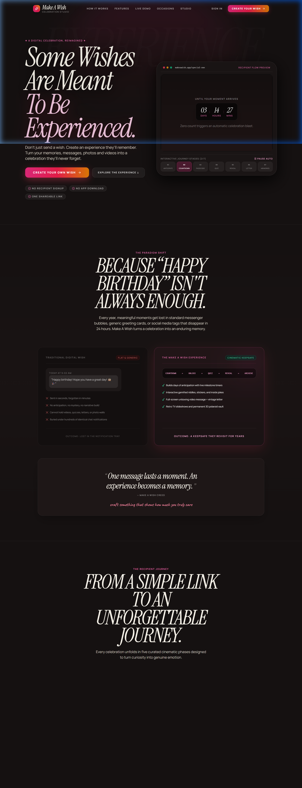
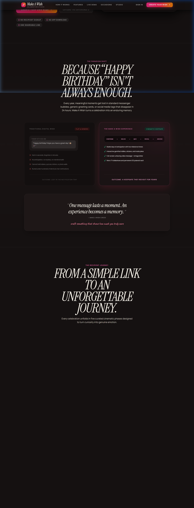
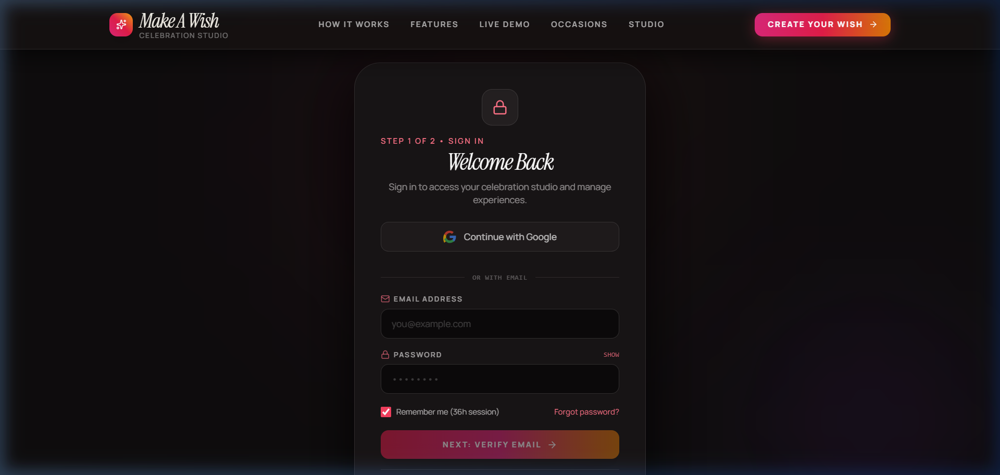

<div align="center">

# ✨ MakeAWish — Cinematic Celebration & Storybook Platform

[](https://makeawishh.vercel.app/)
[](https://makeawish-yo9n.onrender.com/)
[](https://github.com/kushalsaialeti/makeawish)
[](https://opensource.org/licenses/ISC)

<p align="center">
  <strong>Transform simple greetings into unforgettable, interactive digital keepsakes.</strong><br>
  A multi-phase cinematic web experience crafted with React, Three.js, Framer Motion, Node.js, Supabase, and Cloudinary.
</p>

[🌐 Explore Live App](https://makeawishh.vercel.app/) • [🚀 Getting Started](#-getting-started) • [📖 User Guide](#-how-to-use-makeawish) • [📸 Screenshots](#-website-preview--screenshots) • [🛠️ Architecture](#-project-architecture)

---

</div>

## 📌 Table of Contents

- [✨ Overview & Value Proposition](#-overview--value-proposition)
- [🌐 Live Deployment Links](#-live-deployment-links)
- [📸 Website Preview & Screenshots](#-website-preview--screenshots)
- [🚀 Key Features](#-key-features)
- [🏗️ Tech Stack](#️-tech-stack)
- [📁 Project Structure](#-project-structure)
- [⚙️ Setup & Installation](#️-setup--installation)
  - [Prerequisites](#prerequisites)
  - [Environment Variables](#environment-variables)
  - [Option 1: Local Development (Recommended)](#option-1-local-development-recommended)
  - [Option 2: Docker & Docker Compose](#option-2-docker--docker-compose)
- [📖 How to Use MakeAWish](#-how-to-use-makeawish)
  - [For Creators (Building a Wish)](#1-for-creators-building-a-wish)
  - [For Recipients (Experiencing the Magic)](#2-for-recipients-experiencing-the-magic)
- [🔌 API Endpoints Reference](#-api-endpoints-reference)
- [☁️ Deployment Guide](#️-deployment-guide)
- [🛡️ Keep-Alive System](#️-keep-alive-system)
- [🤝 Contributing & License](#-contributing--license)

---

## ✨ Overview & Value Proposition

Traditional text messages, static greeting cards, and social media posts often fail to convey the emotional depth and joy of milestone moments. **MakeAWish** changes this by turning birthdays, anniversaries, and personal milestones into an immersive, multi-stage digital storybook.

### Why MakeAWish?
- 🎭 **Cinematic Narrative Arc**: Unlike a static page, MakeAWish guides the recipient through progressive phases: secret unlock ➡️ teaser countdown ➡️ unboxing & video reveal ➡️ 3D interactive scrapbook.
- 🎨 **Artisan Aesthetic**: Vintage paper textures, bespoke typography, smooth Lenis inertia scrolling, and nostalgic scrapbook aesthetics give each wish the warmth of a handcrafted album.
- ⚡ **No-Code Creator Studio**: Creators can customize recipient details, secret passwords, custom URLs (`/:slug`), photo archives, letters, and video greetings in minutes without writing a single line of code.
- 📱 **Responsive & Fluid Everywhere**: Seamlessly adapts to smartphones, tablets, and desktop displays with smooth 60fps animations.

---

## 🌐 Live Deployment Links

| Component | Provider | Live URL | Description |
| :--- | :--- | :--- | :--- |
| **Frontend Web App** | Vercel | [https://makeawishh.vercel.app](https://makeawishh.vercel.app/) | Interactive client, 3D experience & Creator Studio |
| **Backend REST API** | Render | [https://makeawish-yo9n.onrender.com](https://makeawish-yo9n.onrender.com/) | Express server, Auth, Supabase sync, Media API |
| **Source Code** | GitHub | [https://github.com/kushalsaialeti/makeawish](https://github.com/kushalsaialeti/makeawish) | Open-source monorepo codebase |

---

## 📸 Website Preview & Screenshots

### 1. Landing Page & Cinematic Showcase
The landing page introduces creators to the art of crafting personalized storybooks with interactive previews and dynamic showcase reels.

<div align="center">
  
</div>

<br />

### 2. Immersive Storybook & Interactive Features
Rich typography, 3D coverflow galleries, and zine-style spreads recreate the feel of a physical memory album.

<div align="center">
  
</div>

<br />

### 3. Secret Unlock Experience
Recipients unlock their surprise with a personalized passcode, secret hint, or fingerprint gesture to build anticipation.

<div align="center">
  
</div>

<br />

### 4. Creator Studio & Authentication
A secure portal enabling creators to authenticate, manage multiple celebration projects, and modify story contents with real-time feedback.

<div align="center">
  
</div>

---

## 🚀 Key Features

- **🔐 Interactive Multi-Phase Recipient Journey**:
  1. `/:slug/unlock` — Teaser screen with personalized password or fingerprint trigger.
  2. `/:slug/prepare` — Atmospheric audio countdown sequence preparing the recipient.
  3. `/:slug/gift` — Virtual envelope unboxing containing a heartfelt love note and video greeting.
  4. `/:slug/experience` — The master storybook with Scrapbook Hero, Zine Split Showcase, and 3D Coverflow.
  5. `/:slug/memories` — Polaroid grid showcasing timeless snapshots and captions.
- **🖼️ 3D Coverflow & Scrapbook Gallery**: Powered by Three.js and Framer Motion for tactile physics and card gestures.
- **✍️ Section-by-Section CMS Studio**:
  - Customize hero banners, titles, handwritten accents, and subtitles.
  - Upload memories and photos directly to Cloudinary with automatic resizing and optimization.
  - Author emotional letters with vintage paper styling.
  - Embed surprise video messages.
- **🔗 Custom Vanity Slugs**: Generate clean, shareable URLs (e.g., `makeawishh.vercel.app/lucky-thalli`).
- **🛡️ Secure Authentication**:
  - Email & Password authentication with bcrypt hashing and JWT session tokens.
  - Google OAuth single sign-on integration.
  - Automated password recovery emails powered by Resend.
- **⚡ Real-time Synchronization**: Instant data hydration and state updates backed by Supabase PostgreSQL.
- **⏱️ Automated Cold-Start Prevention**: Built-in keep-alive cron and GitHub Actions to ensure Render free tier instances never sleep.

---

## 🏗️ Tech Stack

### Frontend Client
- **Core Framework**: React 19, TypeScript, Vite
- **Styling**: Tailwind CSS, PostCSS, Radix UI Primitives, Lucide Icons
- **Motion & 3D**: Framer Motion, GSAP, Three.js, `@react-three/fiber`, `@react-three/drei`
- **Interactivity**: Canvas Confetti, `@studio-freight/lenis` (smooth inertia scrolling)
- **State Management**: Zustand
- **Routing**: React Router DOM v7

### Backend API Service
- **Runtime**: Node.js, Express 5, TypeScript
- **Database & Auth**: Supabase (PostgreSQL), Supabase JS Client
- **Authentication**: JWT (JSON Web Tokens), `bcryptjs`, Google OAuth
- **Media Storage**: Cloudinary, Multer, `multer-storage-cloudinary`
- **Email Delivery**: Resend API
- **Scheduling**: `node-cron`

### Infrastructure & DevOps
- **Hosting**: Vercel (Frontend), Render (Backend)
- **Containerization**: Docker, Docker Compose, Nginx
- **Automation**: GitHub Actions (Keep-alive ping scheduling)

---

## 📁 Project Structure

```text
makeawish/
├── .github/
│   └── workflows/
│       └── keep-alive.yml         # Automated GitHub Actions cron pinging services
├── backend/
│   ├── src/
│   │   ├── config/                # Cloudinary, Supabase & DB configurations
│   │   ├── controllers/           # Auth, CMS & Memories business logic
│   │   ├── middlewares/           # JWT authentication & Multer upload middleware
│   │   ├── models/                # TypeScript interfaces and DB schema definitions
│   │   ├── routes/                # Express API routes (auth, cms, memories)
│   │   ├── services/              # Supabase queries, Resend mailer, Keep-alive
│   │   ├── utils/                 # Password helpers & response formatters
│   │   └── index.ts               # Server entry point & cron schedule
│   ├── Dockerfile                 # Production backend container build
│   ├── render.yaml                # Render deployment blueprint
│   ├── tsconfig.json              # Backend TypeScript configuration
│   └── package.json
├── frontend/
│   ├── public/                    # Favicons, vector icons, static assets
│   ├── src/
│   │   ├── assets/                # App artwork and brand logos
│   │   ├── components/
│   │   │   ├── auth/              # Protected route wrappers & login forms
│   │   │   ├── cinematic/         # ScrapbookHero, CoverflowGallery, ZineSplitShowcase
│   │   │   ├── layout/            # Universal Navigation & Footers
│   │   │   ├── motion/            # Lenis SmoothScroll wrappers
│   │   │   └── ui/                # Buttons, dialogs, typography primitives
│   │   ├── pages/
│   │   │   ├── AdminDashboard.tsx # Creator Studio CMS & wish customization
│   │   │   ├── LandingPage.tsx    # High-impact landing page
│   │   │   ├── Login.tsx          # User sign-in
│   │   │   ├── Signup.tsx         # User registration
│   │   │   ├── ResetPassword.tsx  # Password recovery flow
│   │   │   ├── Memories.tsx       # Polaroid memory gallery
│   │   │   └── NotFound.tsx       # Custom 404 page
│   │   ├── store/                 # Zustand stores (authStore, cmsStore)
│   │   ├── App.tsx                # Client routing and phase controller
│   │   ├── main.tsx               # App bootstrap
│   │   └── index.css              # Custom font imports & Tailwind styles
│   ├── Dockerfile                 # Production frontend container with Nginx
│   ├── nginx.conf                 # Nginx SPA fallback configuration
│   ├── vercel.json                # Vercel deployment & rewrite rules
│   ├── tailwind.config.js         # Typography tokens & color palettes
│   └── package.json
├── screenshots/                   # Application screenshots for documentation
│   ├── hero-preview.png
│   ├── features-experience.png
│   ├── interactive-unlock.png
│   └── login-preview.png
├── docker-compose.yml             # Local multi-container development environment
├── .env.example                   # Master environment variables reference
└── README.md                      # Project documentation
```

---

## ⚙️ Setup & Installation

### Prerequisites
Make sure you have the following installed on your system:
- [Node.js](https://nodejs.org/) (v18 or higher recommended)
- [npm](https://www.npmjs.com/) or [yarn](https://yarnpkg.com/)
- [Git](https://git-scm.com/)
- Optional: [Docker](https://www.docker.com/) & Docker Compose

---

### Environment Variables

Before starting the applications, configure your environment files.

#### 1. Backend (`backend/.env`)
Create `backend/.env` based on `.env.example`:

```env
PORT=3001
NODE_ENV=development

# Supabase Credentials
SUPABASE_URL=https://your-project.supabase.co
SUPABASE_SERVICE_ROLE_KEY=your-supabase-service-role-key
VITE_SUPABASE_ANON_KEY=your-supabase-anon-key

# Cloudinary (Media Storage)
CLOUDINARY_CLOUD_NAME=your-cloud-name
CLOUDINARY_API_KEY=your-api-key
CLOUDINARY_API_SECRET=your-api-secret

# JWT Secret
JWT_SECRET=your-super-secret-random-jwt-key

# Transactional Email (Resend)
RESEND_API_KEY=re_your_resend_api_key
EMAIL_FROM=MakeAWish <onboarding@resend.dev>

# Google OAuth (Optional)
GOOGLE_CLIENT_ID=your-google-client-id.apps.googleusercontent.com
GOOGLE_CLIENT_SECRET=your-google-client-secret

# Keep-Alive URLs (Local or Production)
BACKEND_URL=http://localhost:3001
FRONTEND_URL=http://localhost:5173
```

#### 2. Frontend (`frontend/.env`)
Create `frontend/.env`:

```env
# Point to local backend during development or production URL when deploying
VITE_API_URL=http://localhost:3001/api

# Supabase Public Keys
VITE_SUPABASE_URL=https://your-project.supabase.co
VITE_SUPABASE_ANON_KEY=your-supabase-anon-key

# Google OAuth Client ID
VITE_GOOGLE_CLIENT_ID=your-google-client-id.apps.googleusercontent.com
```

---

### Option 1: Local Development (Recommended)

#### Step 1: Clone the repository
```bash
git clone https://github.com/kushalsaialeti/makeawish.git
cd makeawish
```

#### Step 2: Setup and start the Backend
```bash
cd backend
npm install
npm run dev
```
The API server will start on `http://localhost:3001`.

#### Step 3: Setup and start the Frontend
Open a new terminal window:
```bash
cd frontend
npm install
npm run dev
```
The frontend Vite server will be available at `http://localhost:5173`.

---

### Option 2: Docker & Docker Compose

You can launch both the frontend and backend using Docker Compose in a single command:

```bash
# From the root directory
docker-compose up --build
```

- **Frontend**: Accessible at `http://localhost:80` (or `http://localhost:5173`)
- **Backend API**: Accessible at `http://localhost:3001`

To stop the containers:
```bash
docker-compose down
```

---

## 📖 How to Use MakeAWish

### 1. For Creators (Building a Wish)
1. **Register or Log In**: Navigate to [`/signup`](https://makeawishh.vercel.app/signup) or [`/login`](https://makeawishh.vercel.app/login).
2. **Access Creator Studio**: Head to the [Dashboard (`/wishes`)](https://makeawishh.vercel.app/wishes).
3. **Create a New Celebration**:
   - Provide the **Recipient Name** and **Occasion** (e.g., Birthday, Anniversary).
   - Choose a unique URL **slug** (e.g., `for-sarah`, `happy21alex`).
4. **Customize Each Chapter**:
   - **Unlock Phase**: Set a secret passcode or hint known only to you and the recipient.
   - **Hero Storybook**: Add a personalized headline, subtitle, and primary memory photograph.
   - **Love Note & Gift**: Author an heartfelt letter and upload a video message.
   - **3D Coverflow Gallery**: Upload favorite photo moments with timestamps and captions.
5. **Publish & Share**: Toggle **Publish**, copy your bespoke link (`https://makeawishh.vercel.app/your-slug`), and send it to your special someone!

---

### 2. For Recipients (Experiencing the Magic)
When the recipient opens the link:
1. **The Teaser & Unlock** (`/:slug/unlock`): They are greeted with a suspenseful lock screen asking for their passcode or interactive touch confirmation.
2. **The Countdown** (`/:slug/prepare`): An ambient, audio-backed countdown sets the emotional tone.
3. **The Unboxing** (`/:slug/gift`): An animated wax-sealed envelope or gift box opens to reveal the creator's handwritten note and video.
4. **The Storybook** (`/:slug/experience`): They explore the customized scrapbook, featuring interactive 3D photo galleries, floating confetti, and musical ambiance.
5. **The Memory Archive** (`/:slug/memories`): They can revisit polaroid-style photos and messages anytime as a lasting keepsake.

---

## 🔌 API Endpoints Reference

### Authentication Endpoints (`/api/auth`)
| Method | Route | Description | Auth Required |
| :--- | :--- | :--- | :--- |
| `POST` | `/api/auth/signup` | Register a new creator account | No |
| `POST` | `/api/auth/login` | Log in with email and password | No |
| `POST` | `/api/auth/google` | Sign in or sign up with Google OAuth | No |
| `POST` | `/api/auth/forgot-password` | Send password reset email via Resend | No |
| `POST` | `/api/auth/reset-password` | Set new password with reset token | No |
| `GET` | `/api/auth/me` | Fetch authenticated creator's profile | Yes (JWT) |

### CMS & Wish Management (`/api/cms`)
| Method | Route | Description | Auth Required |
| :--- | :--- | :--- | :--- |
| `GET` | `/api/cms/wishes` | List all wishes created by current user | Yes (JWT) |
| `POST` | `/api/cms/wishes` | Create a new wish project with custom slug | Yes (JWT) |
| `GET` | `/api/cms/slug/:slug` | Public recipient view: fetch complete wish | No |
| `PUT` | `/api/cms/:wishId` | Update sections, styling, texts, or settings | Yes (JWT) |
| `DELETE` | `/api/cms/:wishId` | Delete an existing wish project | Yes (JWT) |
| `POST` | `/api/cms/upload` | Upload images or videos directly to Cloudinary | Yes (JWT) |

### System & Health Endpoints
| Method | Route | Description | Auth Required |
| :--- | :--- | :--- | :--- |
| `GET` | `/` | API status health check | No |
| `GET` | `/api/health/supabase` | Supabase connectivity heartbeat ping | No |

---

## ☁️ Deployment Guide

### Deploying the Frontend (Vercel)
1. Fork or push this repository to your GitHub account.
2. Import the repository into [Vercel](https://vercel.com/).
3. Set **Root Directory** to `frontend`.
4. Configure Framework Preset to **Vite**.
5. Add the environment variables:
   - `VITE_API_URL`: Your deployed backend URL (e.g., `https://makeawish-yo9n.onrender.com/api`)
   - `VITE_SUPABASE_URL`: Your Supabase project URL
   - `VITE_SUPABASE_ANON_KEY`: Your Supabase anonymous key
   - `VITE_GOOGLE_CLIENT_ID`: Your Google OAuth client ID (if enabled)
6. Click **Deploy**. Single-page routing is already handled by [`frontend/vercel.json`](./frontend/vercel.json).

### Deploying the Backend (Render)
1. Create a new **Web Service** on [Render](https://render.com/).
2. Select your repository and specify:
   - **Root Directory**: `backend`
   - **Environment**: `Node`
   - **Build Command**: `npm install && npm run build`
   - **Start Command**: `npm run start`
3. Configure all required environment variables in the Render dashboard as documented in [Environment Variables](#environment-variables).
4. Save and deploy.

---

## 🛡️ Keep-Alive System

Free-tier cloud hosting services (such as Render) automatically suspend inactive services after 15 minutes of inactivity, causing cold starts for visitors. 

MakeAWish implements a **Dual-Layer Keep-Alive Architecture**:
1. **GitHub Actions Workflow** ([`.github/workflows/keep-alive.yml`](./.github/workflows/keep-alive.yml)): Automatically triggers every 6 minutes via GitHub Cron to ping both the frontend and backend health endpoints.
2. **Internal Node Cron Engine** ([`backend/src/index.ts`](./backend/src/index.ts)): Pings the backend and frontend services internally every 6 minutes, and keeps the Supabase project active via periodic heartbeats.

This ensures zero cold-start delays when a recipient opens their surprise link!

---

## 🤝 Contributing & License

Contributions, feature requests, and bug reports are warmly welcome!

1. Fork the Project.
2. Create your Feature Branch: `git checkout -b feature/AmazingFeature`
3. Commit your Changes: `git commit -m 'feat: Add some AmazingFeature'`
4. Push to the Branch: `git push origin feature/AmazingFeature`
5. Open a Pull Request.

### License
Distributed under the **ISC License**. See `LICENSE` for more information.

---

<div align="center">
  <p>Crafted with ❤️ to make every celebration unforgettable.</p>
  <p><strong><a href="https://makeawishh.vercel.app">Make A Wish Storybook</a></strong></p>
</div>
